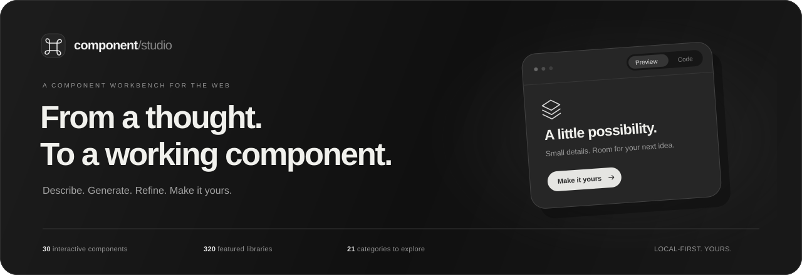
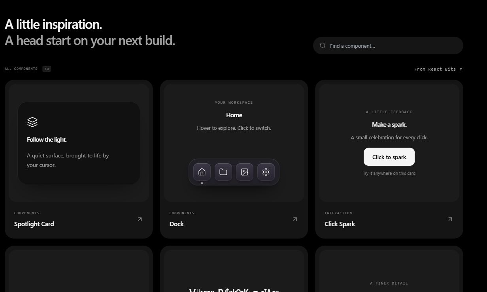
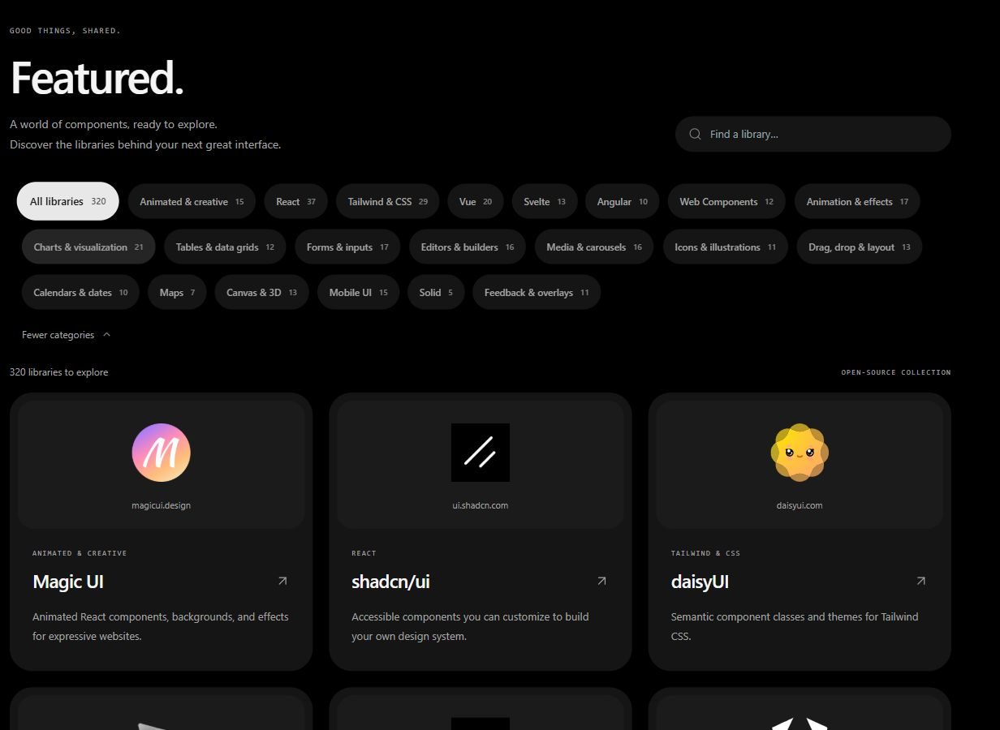

<p align="center">
  
</p>

<h1 align="center">Component Studio</h1>

<p align="center">
  Describe an interface. Shape it live. Take the source with you.<br />
  A local React workbench for AI generation, interactive components, and a world of UI libraries.
</p>

<p align="center">
  <a href="https://nextjs.org/"></a>
  <a href="https://react.dev/"></a>
  <a href="https://www.typescriptlang.org/"></a>
  <a href="https://tailwindcss.com/"></a>
</p>

<p align="center">
  <a href="#the-workbench">Explore</a> ·
  <a href="#quick-start">Quick start</a> ·
  <a href="#connect-your-model">Connect a model</a> ·
  <a href="#development">Development</a> ·
  <a href="#credits--licensing">Credits</a>
</p>

<br />

<table>
  <tr>
    <td align="center" width="33%"><strong>30</strong><br /><sub>INTERACTIVE COMPONENTS</sub></td>
    <td align="center" width="34%"><strong>320</strong><br /><sub>FEATURED LIBRARIES</sub></td>
    <td align="center" width="33%"><strong>21</strong><br /><sub>LIBRARY CATEGORIES</sub></td>
  </tr>
</table>

## The workbench

Browse **313 agent skills across 9 categories** in the new **Skills** section,
with search, topic filters, and links to the original Skill Issue listings.
See [catalog provenance](docs/skills-catalog.md) for sources and snapshot details.

Start with a prompt, an image reference, or a component from the built-in library. Watch the result take shape, adjust its properties, and refine it through conversation or direct source edits.

<p align="center">
  
</p>

| | What you can do |
| :--- | :--- |
| **Build with AI** | Stream component generation, attach image references, choose thinking effort, and follow up with changes. |
| **Preview live** | Run components in an isolated iframe, switch themes and viewport sizes, and adjust properties without losing preview state. |
| **Own the source** | Read or edit source in separate views, move between local versions, copy TypeScript or JavaScript, and download a component project as a ZIP. |
| **Keep your work** | Reopen browser-saved builds, favorite and rename them, or export and import a history backup. |
| **Explore the ecosystem** | Search 320 libraries across 21 categories, with local logo assets, animated filters, and incremental loading. |
| **Enjoy the details** | Light and dark themes, soft blur transitions, spring interactions, responsive layouts, keyboard controls, and reduced-motion support. |

### A directory for your next idea

React, Vue, Svelte, Angular, Solid, Web Components, and Tailwind & CSS — alongside animation, charts, data grids, forms, editors, media, icons, drag-and-drop, calendars, maps, canvas, 3D, mobile UI, and overlays.

<details>
  <summary><strong>See Featured — 320 libraries, 21 categories</strong></summary>
  <br />
  
</details>

## Quick start

Use **Node.js 20 or newer** and npm.

```bash
git clone https://github.com/AdityaRoy999/component-studio.git
cd component-studio
npm ci
npm run dev -- --port 9334
```

Open **[localhost:9334](http://localhost:9334)**.

The component library and Featured directory work immediately. To generate components, connect a model in **AI settings**.

## Connect your model

Open **AI settings**, choose a provider, enter your API key, and select an available model. You can save up to **20 named model configurations** and switch the active configuration before generating.

| Provider | Server key | Optional model setting |
| :--- | :--- | :--- |
| Google Gemini | `GEMINI_API_KEY` | `GEMINI_MODEL` |
| OpenAI | `OPENAI_API_KEY` | `OPENAI_MODEL` |
| Groq | `GROQ_API_KEY` | `GROQ_MODEL` |
| OpenRouter | `OPENROUTER_API_KEY` | `OPENROUTER_MODEL` |
| NVIDIA NIM | `NVIDIA_API_KEY` | `NVIDIA_MODEL` |
| Custom OpenAI-compatible endpoint | `CUSTOM_API_KEY` if required | `CUSTOM_MODEL` + `CUSTOM_BASE_URL` |

### Prefer environment variables?

Copy [`.env.example`](.env.example) to `.env.local` and set the providers you use:

```dotenv
GEMINI_API_KEY=your_key_here
```

Restart the development server after changing environment variables. Browser-supplied credentials take precedence over server settings. Hosted generation uses your provider's quota and billing.

### Local and custom models

Choose **Custom provider** and enter an OpenAI-compatible API base URL, such as `http://localhost:11434/v1`, plus the exact model ID served by that endpoint. A key is optional when the endpoint does not require one. **Test connection** checks model discovery before you generate.

Requests originate from the Next.js server, so `localhost` refers to the computer running Component Studio.

### Where your data lives

- **Model configurations and browser-entered keys** are stored in this browser's local storage. Server-configured keys stay in environment variables.
- **Build history, conversations, image references, and workspace drafts** are saved in this browser's IndexedDB.
- **Generation requests** send the prompt and attached references to your selected provider.
- **Project downloads** contain component source and selected customization; provider credentials are excluded.

## Development

| Command | Purpose |
| :--- | :--- |
| `npm run dev -- --port 9334` | Start the local development server. |
| `npm test` | Run backend and generation regression tests with mocked providers. |
| `npm run test:integration` | Exercise local HTTP routes; start the app on port 9334 first. |
| `node scripts/check-featured.cjs` | Validate catalog counts, unique entries, logo files, hashes, and license evidence. |
| `npm run build` | Create and type-check a production build. |
| `npm run start -- --port 9334` | Serve the production build. |

Tests use mocked providers or local fixtures and do not require paid model generation. Set `TEST_BASE_URL` when running integration tests against another local port.

Development uses `.next-dev`; production uses `.next`. For an isolated production build, keep `STUDIO_BUILD_DIR` set to the same directory for build and start:

```powershell
$env:STUDIO_BUILD_DIR = '.next-production'
npm run build
npm run start -- --port 9334
```

### Project structure

```text
src/
├── app/                    Pages, shared styles, and API routes
├── components/
│   ├── studio/             Workbench, catalog, history, and Featured
│   └── reactbits/          Adapted interactive components
├── data/                   Component presets and library catalogs
└── lib/                    Providers, compilation, exports, and persistence
public/                     Local logos and demo assets
scripts/                    Catalog validation and source-asset tooling
tests/                      Backend, generation, and HTTP regression tests
docs/                       Architecture, evidence, and product screenshots
third_party/                Source notices, attribution, and licenses
```

For the request flow, preview boundaries, and endpoint reference, see **[Architecture](docs/architecture.md)**. Generation validation is documented in **[Generation quality](docs/generation-quality.md)**.

## Credits & licensing

- **[React Bits](https://reactbits.dev/)** — interactive components and motion details. Bundled source retains its **[MIT + Commons Clause license](third_party/reactbits/LICENSE.md)** and [source notice](third_party/reactbits/NOTICE.md).
- **[Thinking Orbs](https://www.thinkingorbs.com/)** — generation activity indicators.
- **[Ponytail](third_party/ponytail/README.md)** — prompt guidance, with its original MIT license retained.
- **[Motion](https://motion.dev/), [GSAP](https://gsap.com/), and [Lenis](https://lenis.darkroom.engineering/)** — animation and scrolling.
- **[Lucide](https://lucide.dev/), [Tabler](https://tabler.io/icons), and [Hugeicons](https://hugeicons.com/)** — interface icons.
- **[Lobe Icons](https://github.com/lobehub/lobe-icons) and [Simple Icons](https://github.com/simple-icons/simple-icons)** — provider marks; see the [provider asset notice](public/providers/NOTICE.txt).

Third-party code and brand assets retain their respective licenses and trademarks. The repository does not apply a blanket MIT license to all bundled material. Featured links point to independent projects; some also offer paid products alongside their free libraries.

<br />

<p align="center">
  <sub>Made for the space between an idea and a working interface.</sub><br />
  <sub>Built by <a href="https://github.com/AdityaRoy999">Aditya Roy</a>.</sub>
</p>
